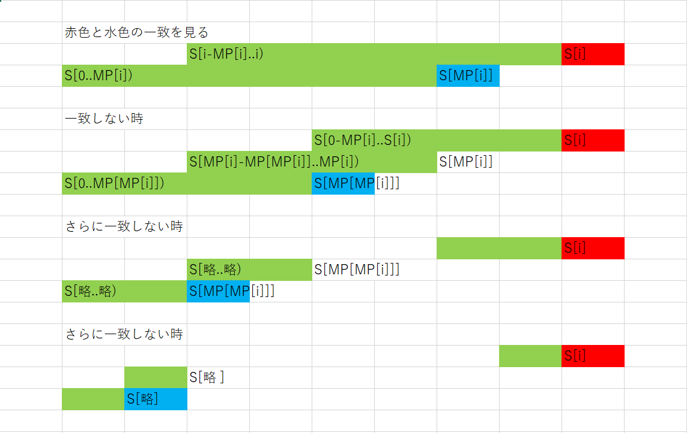

# MP法(Morris–Pratt algorithm)
文字列 $S$に対して、以下を満たす長さ $|S|+1$の $MP$配列を構築する。
- $MP[0] := -1$
- $MP[i+1] := S[0..x) = S[i-x..i)となる最大のx(i-x>0)$

# 例
 $S$=abacababが入力として与えられた時<br>
 $MP$=[-1,0,0,1,0,1,2,3,2]を返す

# 使用例
文字列 $T$に対してMP配列を求めておくことで、文字列 $S$に文字列 $T$が含まれるか及びその場所を、<br>
前計算 $\mathcal{O}(|T|)$ の後、 $\mathcal{O}(|S|)$で求められる。<br>
 $T$を固定して様々な $S$に対して処理を行いたいときに有用

# 注
KMP法(Knuth-Morris-Pratt)とは異なるものである<br>
Web上でKMP法で検索して出てくるものの殆どはMP法である。

# アルゴリズム
## 手順
 $i$の昇順に以下の手順を行う。
- 変数 $j$を $MP[i]$で初期化する。
- $j≠-1$ かつ $S[j]≠S[i]$である間、 $j=MP[j]$と更新する。
- $j$を $j+1$に更新する。
- $MP[i+1]$に $j$を代入する。

## 図示


## 計算量解析
$j$の更新に着目します。<br>
２番目の処理の中で、 $j$は減少します。( $j \geq -1$ )<br>
また、３番目の処理で $+1$されます。<br>
減少させるためには、その分増加させる必要があるため減る方向に $j$が更新される回数は高々 $\mathcal{O}(|S|)$になることがわかります。<br>
よって全体でも $\mathcal{O}(|S|)$になることがわかります。

## 実装
```cpp
template<typename T>
class MP {
public:
	MP(const T& t) : t(t) {
		build();
	}
	std::vector<int> findAll(const T& s) {
		std::vector<int> res;
		int j = 0;
		for (int i = 0; i < s.size(); ++i) {
			while (j != -1 && t[j] != s[i]) j = a[j];
			j++;
			if (j == n) {
				res.push_back(i - j + 1);
				j = a[j];
			}
		}
		return res;
	}
private:
	int n;
	T t;
	std::vector<int> a;
	void build() {
		n = t.size();
		a = std::vector<int>(n + 1);
		a[0] = -1;
		int j = -1;
		for (int i = 0; i < n; ++i) {
			while (j != -1 && t[j] != t[i]) j = a[j];
			j++;
			a[i + 1] = j;
		}
	}
};
```